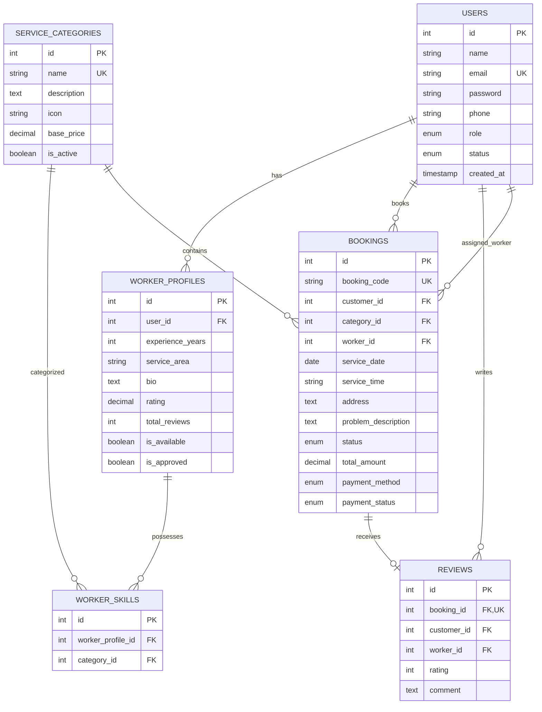

# HomeServe – On-Demand Home Services Booking Platform

[](https://nodejs.org/)
[](https://expressjs.com/)
[](https://reactjs.org/)
[](https://vitejs.dev/)
[](https://www.mysql.com/)
[](https://jwt.io/)
[](https://opensource.org/licenses/MIT)

An enterprise-grade, full-stack on-demand home services web application designed and built for real-world service commerce. **HomeServe** connects residential consumers with verified local service professionals across diverse home maintenance domains (Plumbing, Electrical, Appliance Repair, Cleaning, HVAC, and more).

Built with a high-performance **React.js SPA** frontend (styled with custom **Vanilla CSS3**), a scalable **Node.js & Express.js REST API** backend, and an **ACID-compliant MySQL 8.0 relational database**.

---

## 📑 Table of Contents

- [Key Highlights](#-key-highlights)
- [System Architecture](#-system-architecture)
- [Multi-Role Features](#-multi-role-features)
  - [Customer Experience](#1-customer-experience)
  - [Service Provider Experience](#2-service-provider-experience)
  - [Administrative Command Center](#3-administrative-command-center)
- [Database Architecture](#-database-architecture)
- [API Endpoints Reference](#-api-endpoints-reference)
- [Project Directory Structure](#-project-directory-structure)
- [Quick Start & Local Setup](#-quick-start--local-setup)
- [Pre-Seeded Demo Credentials](#-pre-seeded-demo-credentials)
- [Automated End-to-End Testing](#-automated-end-to-end-testing)
- [Deployment](#-deployment)
- [License](#-license)

---

## 🌟 Key Highlights

- **Complete Multi-Role RBAC**: Strict role-based access control protecting routes for `CUSTOMER`, `SERVICE_PROVIDER`, and `ADMIN`.
- **Atomic Booking Dispatching**: Prevents race conditions when multiple providers attempt to claim the same service request simultaneously.
- **Sequential Lifecycle Progression**: Linear state transitions (`PENDING` → `ACCEPTED` → `ON_THE_WAY` → `IN_PROGRESS` → `COMPLETED`) with automated payment settlement.
- **Bi-Directional Trust Engine**: Verified provider onboarding and automated rolling aggregate rating recalculation upon review submission.
- **Zero Third-Party CSS Overhead**: 100% custom, lightweight Vanilla CSS3 design system with responsive layouts, glassmorphism, skeleton loading, and micro-interactions.
- **Security First**: Passwords salted and hashed with `bcryptjs`, tamper-proof stateless JWTs, parameterized SQL queries defending against SQL injection, and sanitized input validation via `express-validator`.

---

## 🏛 System Architecture

```
                                  [ CLIENT TIER ]
                     React.js SPA (Vite + Vanilla CSS3)
                                  Port 5173
                                      │
                                      ▼ HTTPS / JSON REST
                               [ APPLICATION TIER ]
                         Node.js + Express.js REST Server
                                  Port 5000
       ┌──────────────────────────────┼──────────────────────────────┐
       ▼                              ▼                              ▼
 [Auth Middleware]           [Validation Layer]            [REST Controllers]
  - JWT Verification          - express-validator           - Auth & Users
  - Role Authorization        - Sanitization                - Categories & Bookings
  - Account State Checks                                    - Worker Jobs & Reviews
                                                            - Admin Auditing
                                      │
                                      ▼ mysql2 / Connection Pool
                                 [ DATA TIER ]
                            MySQL 8.0 Relational DB
                    InnoDB Engine | Foreign Keys | Indexing
```

---

## 👥 Multi-Role Features

### 1. Customer Experience
- **Catalog Browsing**: Real-time search, category cards, and transparent baseline pricing.
- **Multi-Step Booking Wizard**: Select date, preferred time slot, address, and detailed problem description with instant cost estimation.
- **Visual Order Tracking**: Interactive 5-step horizontal tracker reflecting live job updates.
- **Review & Rating Modal**: Post-service 1-to-5 star evaluation with feedback comments.

### 2. Service Provider Experience
- **Smart Job Feed**: Category-filtered discovery matching only the provider's verified skills.
- **One-Click Atomic Claiming**: Concurrency-safe job acceptance.
- **Status Stepper**: Real-time status advancement (`ACCEPTED` → `ON_THE_WAY` → `IN_PROGRESS` → `COMPLETED`).
- **Earnings & Rating Analytics**: Metrics displaying lifetime completed jobs, accumulated revenue, and rolling average ratings.

### 3. Administrative Command Center
- **System KPIs**: High-level telemetry covering gross platform revenue, total bookings, active categories, and provider counts.
- **Service Management**: Add, update, and toggle active/inactive states for service categories.
- **Worker Verification**: Review provider applications and toggle verified/approved status.
- **User Governance**: One-click account suspension and activation for platform moderation.
- **Audit Trails**: Global inspection of all bookings with real-time status filtering.

---

## 🗄 Database Architecture

The data tier is powered by **MySQL 8.0** with strict referential integrity and foreign key constraints:



---

## 🔌 API Endpoints Reference

### Authentication & Profiles (`/api/auth`)
| Method | Endpoint | Access | Description |
| :--- | :--- | :--- | :--- |
| `POST` | `/api/auth/register` | Public | Register Customer or Service Provider |
| `POST` | `/api/auth/login` | Public | Authenticate user & issue JWT bearer token |
| `GET` | `/api/auth/me` | Authenticated | Retrieve authenticated user profile |

### Service Categories (`/api/services`)
| Method | Endpoint | Access | Description |
| :--- | :--- | :--- | :--- |
| `GET` | `/api/services` | Public | List all active categories (supports `?search=`) |
| `GET` | `/api/services/:id` | Public | Retrieve single category details |

### Bookings & Customer Portal (`/api/bookings`, `/api/customer`)
| Method | Endpoint | Access | Description |
| :--- | :--- | :--- | :--- |
| `POST` | `/api/bookings` | Customer | Create booking request with unique code |
| `GET` | `/api/customer/bookings` | Customer | List customer's booking history |
| `GET` | `/api/customer/bookings/:id` | Customer / Admin | Get full booking details with status log |
| `PUT` | `/api/bookings/:id/cancel` | Customer / Admin | Cancel a pending or scheduled booking |

### Service Provider Portal (`/api/worker`)
| Method | Endpoint | Access | Description |
| :--- | :--- | :--- | :--- |
| `GET` | `/api/worker/jobs` | Provider | Fetch matching open requests by skill |
| `PUT` | `/api/worker/jobs/:id/accept` | Provider | Concurrency-safe atomic job claim |
| `PUT` | `/api/worker/jobs/:id/status` | Provider | Progress job status (`ON_THE_WAY`, `COMPLETED`, etc.) |
| `GET` | `/api/worker/dashboard` | Provider | Provider metrics, earnings, and reviews |

### Reviews & Ratings (`/api/reviews`)
| Method | Endpoint | Access | Description |
| :--- | :--- | :--- | :--- |
| `POST` | `/api/reviews` | Customer | Submit 1-5 star review for completed booking |
| `GET` | `/api/reviews/worker/:id` | Public | List verified reviews for a specific worker |

### Admin Portal (`/api/admin`)
| Method | Endpoint | Access | Description |
| :--- | :--- | :--- | :--- |
| `GET` | `/api/admin/dashboard` | Admin | Overall revenue, booking KPIs, and user metrics |
| `GET` | `/api/admin/bookings` | Admin | Comprehensive list of all platform bookings |
| `POST` | `/api/admin/categories` | Admin | Create a new service category |
| `PUT` | `/api/admin/categories/:id` | Admin | Update existing service category |
| `PUT` | `/api/admin/workers/:id/approve` | Admin | Toggle provider approval status |
| `PUT` | `/api/admin/users/:id/status` | Admin | Suspend or activate user accounts |

---

## 📁 Project Directory Structure

```
HomeServe/
├── .gitignore
├── DEPLOYMENT.md
├── README.md
│
├── homeserve-backend/
│   ├── .env.example
│   ├── database.sql
│   ├── package.json
│   ├── test_e2e.js
│   └── src/
│       ├── app.js
│       ├── server.js
│       ├── config/          # db.js (MySQL connection pool)
│       ├── controllers/     # auth, service, booking, worker, review, admin
│       ├── middleware/      # auth, error, validate
│       ├── models/          # user, service, booking, worker, review, admin
│       ├── routes/          # express route modules
│       └── utils/           # responseHandler, token
│
└── homeserve-frontend/
    ├── .env.example
    ├── index.html
    ├── package.json
    ├── vercel.json
    ├── vite.config.js
    ├── public/
    │   └── _redirects
    └── src/
        ├── App.jsx
        ├── main.jsx
        ├── index.css        # Design tokens, responsive media queries, animations
        ├── components/      # Navbar, Footer, StatusTracker, ReviewModal, ServiceCard, ProtectedRoute
        ├── context/         # AuthContext
        ├── pages/           # Home, ServiceDetails, BookService, Login, Register, Dashboards, NotFound
        └── services/        # Axios API client with JWT interceptors
```

---

## 🚀 Quick Start & Local Setup

### Prerequisites
- [Node.js](https://nodejs.org/) (v18.0 or higher)
- [MySQL Server](https://dev.mysql.com/downloads/mysql/) (v8.0 or higher)

### 1. Database Setup
1. Open your MySQL client (MySQL CLI, MySQL Workbench, etc.).
2. Execute the database initialization script:
```powershell
mysql -u root -p < c:\Users\sunka\OneDrive\Desktop\HomeServe\homeserve-backend\database.sql
```
*(Enter your MySQL root password when prompted)*.

### 2. Backend Setup
1. Open a terminal in `homeserve-backend`:
```powershell
cd c:\Users\sunka\OneDrive\Desktop\HomeServe\homeserve-backend
npm install
```
2. Verify `.env` matches your MySQL credentials:
```env
PORT=5000
NODE_ENV=development
DB_HOST=localhost
DB_USER=root
DB_PASSWORD=root
DB_NAME=homeserve
DB_PORT=3306
JWT_SECRET=super_secret_jwt_key_homeserve_2026_capstone_secure
JWT_EXPIRES_IN=7d
CLIENT_URL=http://localhost:5173
```
3. Start the backend development server:
```powershell
npm run dev
```

### 3. Frontend Setup
1. Open a second terminal in `homeserve-frontend`:
```powershell
cd c:\Users\sunka\OneDrive\Desktop\HomeServe\homeserve-frontend
npm install
npm run dev
```
2. Open your browser and navigate to:
```
http://localhost:5173
```

---

## 🔑 Pre-Seeded Demo Credentials

All demo accounts are pre-seeded with the password: **`Password123!`**

| Role | Email | Password | Primary Capabilities |
| :--- | :--- | :--- | :--- |
| **Customer** | `customer@homeserve.com` | `Password123!` | Book services, track live status, post reviews |
| **Provider** | `worker@homeserve.com` | `Password123!` | Discover jobs, accept requests, update progress |
| **Admin** | `admin@homeserve.com` | `Password123!` | Platform revenue KPIs, categories CRUD, approvals |

> **Tip**: The login page includes convenient **1-Click Demo Account Autofill** buttons for instant testing.

---

## 🧪 Automated End-to-End Testing

HomeServe includes a standalone automated verification script that executes a complete 7-stage lifecycle across the REST APIs:
1. API Health Check
2. Customer Authentication
3. Service Booking Creation
4. Service Provider Discovery & Skill Matching
5. Atomic Claiming & Status Progression (`ACCEPTED` → `ON_THE_WAY` → `IN_PROGRESS` → `COMPLETED`)
6. Rating & Review Submission
7. Admin Revenue & KPI Validation

Run the test with the backend server running:
```powershell
cd c:\Users\sunka\OneDrive\Desktop\HomeServe\homeserve-backend
node test_e2e.js
```

---

## 🌐 Deployment

For complete, step-by-step instructions on deploying the frontend to **Vercel**, backend to **Render**, and database to a managed cloud MySQL provider, refer to the [Cloud Deployment Guide](DEPLOYMENT.md).

---

## 📄 License

This project is licensed under the [MIT License](LICENSE).
